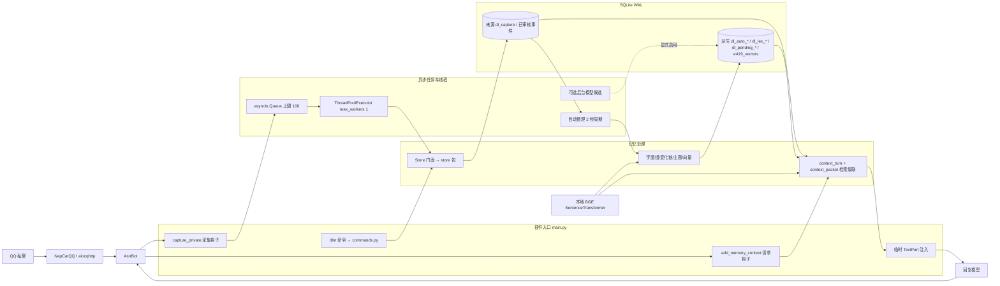
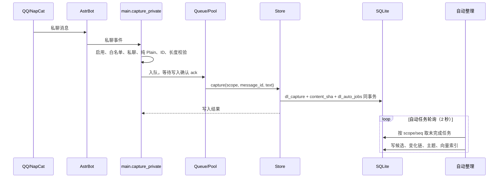
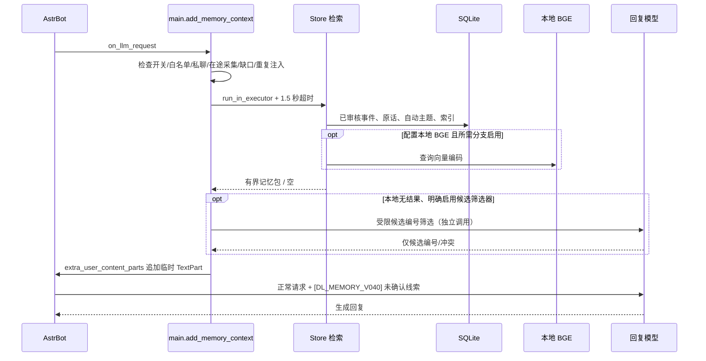

# Digital Life 代码架构

- 仓库：<https://github.com/weijiecao/digital-life>（完整工程）；插件发行仓库
  <https://github.com/weijiecao/astrbot_plugin_digital_memory_store>
- 对应版本：**v1.0.12**（`metadata.yaml`）
- 依据：`main` 分支源码静态核对 + 本机 **339 项离线回归**（GitHub Actions 跑同一套）；真实环境性能未认证
- 更新：2026-11-05（v1.0.9–v1.0.11 完成 `storage.py` / `main.py` / `commands.py` 拆分后重写）

## 1. 系统架构

> 这是职责与数据流图，不是严格的线程内调用序列。采集、检索、自动整理中的数据库工作都通过同一个
> 单工作线程执行池调度；BGE 首次预热另有后台线程。图中“已审核事件”与自动主题**不是**同一信任等级。

## 2. 消息写入链

## 3. 模型请求与记忆读取链

## 4. 数据层分组

| 数据组 | 典型表 | 信任含义 |
|---|---|---|
| 原始采集 | `dl_capture`、`dl_import_provenance` | 用户原话与采集信息，可校验但不自动证明陈述为真 |
| 已审核来源与事件 | `messages`、`events`、`e417_ingest`、`e417_phase` | 来源绑定的已审核结构化事件 |
| 自动整理候选 | `dl_auto_localization`、`dl_auto_groups`、`dl_auto_chains`、`dl_auto_topics`、`dl_auto_topic_members` | 系统推测，不自动进入已审核事实 |
| 字面与语义索引 | `dl_lex_terms`、`dl_pending_terms`、`dl_auto_source_vectors`、`e419_vectors` | 可重新生成的检索加速数据 |
| 状态、安全与任务 | `dl_capture_gaps`、`dl_auto_jobs`、`dl_auto_model_jobs`、`dl_auto_separations` | 缺口、重试、反向证据与回退状态 |
| 候选草稿 | `dl_model_drafts`、`dl_group_drafts`、`dl_source_briefs` | 来源绑定候选与摘要，需区分是否审核 |

> 表名已逐条对照 `store/`、`lexical_index.py`、`pending_index.py`、`engine/e419/dynamic_index.py`
> 的实际 `CREATE TABLE`。

## 5. 文件与职责

| 位置 | 职责 |
|---|---|
| `main.py`（721 行） | AstrBot `Star` 入口：采集/注入钩子、授权、队列、线程池、面板 API 注册、生命周期 |
| `commands.py`（806 行） | `/dlm` 分发：`_work` 9 行路由 → 7 个命令族处理器（状态/待审/分组/采集/摘要/事件/帮助）；草稿生成与渲染 |
| `storage.py`（5 行） | 兼容层，`Store` 与常量从 `store/` 包导出（旧导入路径保持不变） |
| `store/`（15 个模块） | `base`（常量与写锁）、`embedding`、`capture`、`drafts`、`events`、`organize`、`relations`、`briefs`、`context_sources/packet/followup`、`backup`、`core`（组合入口） |
| `auto_organize.py` | 自动整理持久队列；字面分组、短句变化和连续变化链 |
| `auto_topics.py`、`auto_topology.py`、`auto_cross_update.py` | 推测主题归组、冲突回退、跨主题变更线索 |
| `auto_model.py`、`model_judge.py`、`model_drafts.py`、`model_groups.py`、`new_groups.py` | 显式开启后的有限模型候选、筛选与草稿 |
| `lexical_index.py`、`pending_index.py` | 已审核事件与待审原文的增量字面索引 |
| `engine/e418/engine.py` | `UnifiedMemoryEngine`：统一来源-事件与审核关系 |
| `engine/e419/dynamic_index.py` | 已审核事件向量检索与缓存 |
| `engine/e32/cpu_model.py`、`engine/e31/local_model.py` | 离线 SentenceTransformer / BGE CPU 编码适配（不联网、不隐式用 GPU） |
| `engine/README.md` | 实验编号（e31/e32/e417…）的调用链与边界说明 |
| `panel.py`、`recovery.py`、`views/panel/` | 控制面板、备份检验、非覆盖式恢复 |
| `history_import.py` | 历史 JSONL 的严格校验与整批导入：单事务写 `dl_capture` + `dl_import_provenance`，只导入为待审；由 `/dlm 导入历史 <文件名>.jsonl` 调用（文件必须位于 `imports/`） |
| `preflight.py` | 启动自检：缺依赖/缺模型/目录错误 → 一条可复制的提示 |
| `docs/` | 给使用者的快速开始、排错、本架构说明 |

## 6. 静态代码审查结论

**已具备**：原文采集、SHA 校验（`content_sha`）、白名单与会话隔离、单文件 SQLite WAL、持久整理任务、
主题/变化候选、字面与 BGE 语义检索、有界上下文注入、缺口标记、备份与面板。

**需要重点验证**：

1. 所有采集、检索、整理 DB 工作共用 `ThreadPoolExecutor(max_workers=1)`，长历史/索引回填时存在争用风险；
   `1.5` 秒超时是保护机制，不等于性能保证。
2. 采集钩子要求消息段全部是 `Plain`，图片/视频/音频与混合消息当前被直接跳过；多模态需要改造入库源模型，
   而不只是换向量模型。
3. `always_context_enabled` 默认启用时，未匹配也可能给较早原话作背景；噪声与误联想需在真实对话上评估。
4. 自动主题与模型候选**永不自动提升**为已审核事实。这是事实保真保护，也意味着“自动模式”与“审核事件模式”
   双轨并存。
5. 模型候选/草稿显式启用后会向所选 Provider 发送用户原话；本地 BGE 路径不需要这样做。
6. `/dlm` 人工命令与 panel 是独立接口；“全自动整理”必须单独验收，不能用人能查通代替。

**已消项**（原文档列为待办）：

7. ~~`storage.py` 2800 多行、职责过多，建议向后兼容地拆分~~ —— 已在 v1.0.9–v1.0.11 完成：
   `storage.py` 变 5 行兼容层，`store/` 15 个模块；`main.py` 1520 → 721 行；`_work` 487 行 → 9 行路由 +
   7 个命令族。全程保持旧导入路径，339 项回归未降级。

## 7. 代码规模（重构后）

| 文件/包 | 行数 | 说明 |
|---|---|---|
| `main.py` | 721 | 钩子、生命周期、面板注册 |
| `commands.py` | 806 | `_work` 9 行 + 7 个 `_cmd_*` |
| `store/` | 3185 | 最大单文件 `context_sources.py` 475 行 |
| `auto_*.py` | 1591 | 自动整理与模型候选 |
| `engine/` | 1065 | 实验编号模块，见 `engine/README.md` |

构建产物：`astrbot_plugin_digital_memory_store-<version>.zip`（69 个文件，约 0.18 MB），
通过 AstrBot 4.29.3 自带 `inspect_plugin_archive` 校验。

## 8. 主要源码链接

- [main.py](https://github.com/weijiecao/astrbot_plugin_digital_memory_store/blob/main/main.py)
- [commands.py](https://github.com/weijiecao/astrbot_plugin_digital_memory_store/blob/main/commands.py)
- [store/core.py](https://github.com/weijiecao/astrbot_plugin_digital_memory_store/blob/main/store/core.py)
- [storage.py（兼容层）](https://github.com/weijiecao/astrbot_plugin_digital_memory_store/blob/main/storage.py)
- [auto_organize.py](https://github.com/weijiecao/astrbot_plugin_digital_memory_store/blob/main/auto_organize.py)
- [auto_topics.py](https://github.com/weijiecao/astrbot_plugin_digital_memory_store/blob/main/auto_topics.py)
- [engine/e418/engine.py](https://github.com/weijiecao/astrbot_plugin_digital_memory_store/blob/main/engine/e418/engine.py)
- [engine/e419/dynamic_index.py](https://github.com/weijiecao/astrbot_plugin_digital_memory_store/blob/main/engine/e419/dynamic_index.py)
- [配置 schema](https://github.com/weijiecao/astrbot_plugin_digital_memory_store/blob/main/_conf_schema.json)

## 9. 审查边界

- 本文是**静态源码核对 + 离线回归**的结论，不代表生产环境性能认证；
- 真实链路（真实 AstrBot + 真实 BGE + 真实 QQ）另有证据：`dev/docs/REAL_ENV_REPORT.md`、`dev/reports/`；
- 数据表、超时值、线程池与队列上限、注入方式均已对照代码核对；文档与代码不一致时**以代码为准**，
  并请提 issue 指出。
