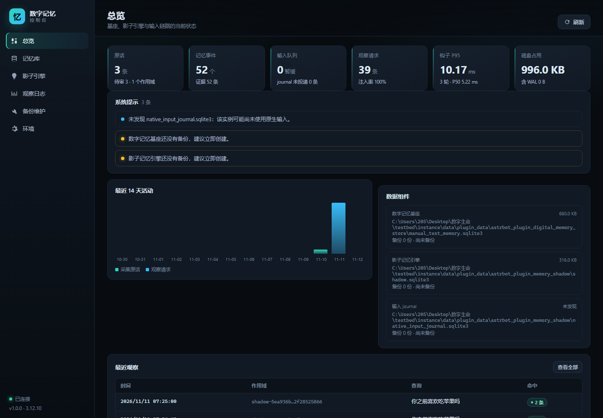
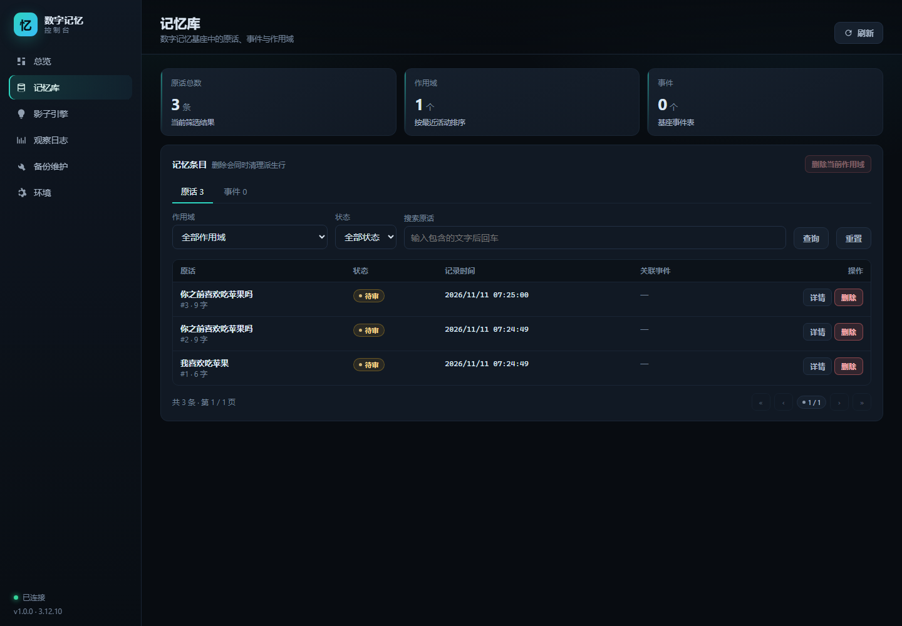
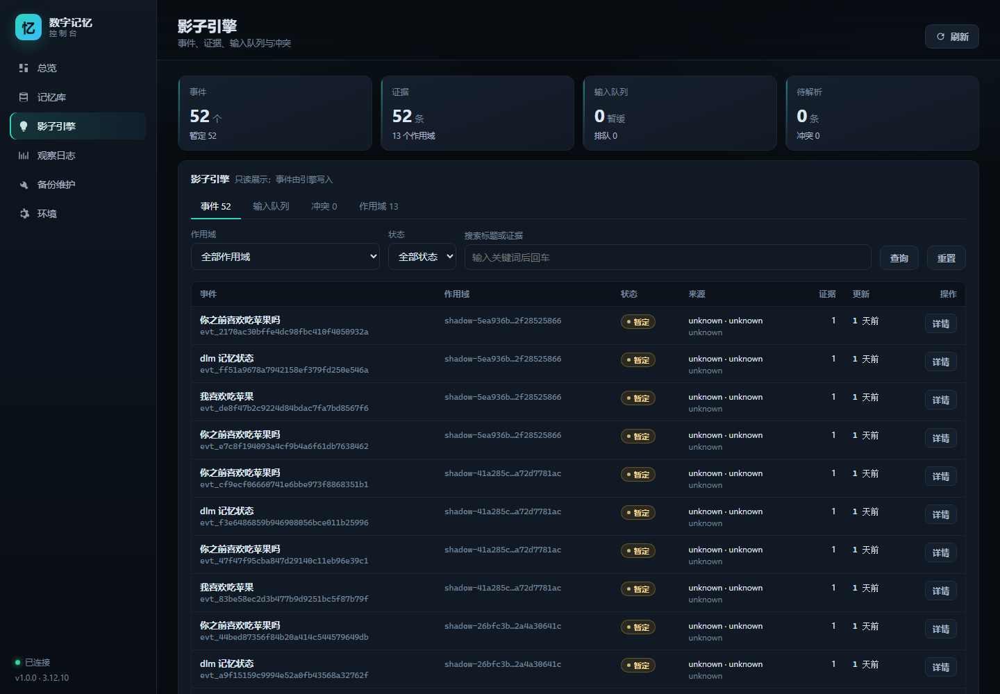

# 数字记忆控制台（独立本地 Web）

面向整个数字记忆系统的本机管理台：同时查看 **数字记忆基座**、**影子引擎**、**原生输入 journal** 与
**观察/延迟日志**，并提供备份、轮转、checkpoint、完整性检查、VACUUM 和归档导出。

- 只依赖 Python 标准库，不需要 Node、数据库客户端或 AstrBot 前端；
- 默认只监听 `127.0.0.1`，每次启动生成一次性令牌；
- 只读取已有数据库，不创建、不迁移、不改引擎数据；
- 事件与证据只读；只有基座原话支持删除（等价于插件 WebUI panel 的管理员删除）。

## 嵌入 AstrBot 插件页

`host_shadow` 已把同一套控制台注册为 AstrBot 插件页：

- WebUI → 插件 → **Memory Engine Shadow** → 视图 **数字记忆控制台**；
- 页面由 AstrBot 提供，不需要额外端口、令牌或浏览器地址；
- API 路径为 `/astrbot_plugin_memory_shadow/console/*`，由 `host_shadow/console_api.py` 复用本目录的 `Console`；
- `SHADOW_CONSOLE_READONLY=1` 可禁用备份/恢复/删除/VACUUM；
- 独立启动 `python -m dlm_console` 仍然保留，适合离线查看或 AstrBot 未运行时使用。

前端只有一份源：`dev/dlm_console/web/`。修改后同步到插件视图：

```powershell
cd dev
python scripts\sync_console_view.py
```

测试 `tests/test_host_shadow_console.py` 会校验两边资源完全一致。

## 启动

在工程根目录双击 **`启动数字记忆控制台.cmd`**，或：

```powershell
cd dev
python -m dlm_console
```

浏览器会自动打开，终端里也会打印带令牌的地址。默认端口 `8788`，被占用时自动向后寻找。

指定 AstrBot 实例（默认自动寻找 `testbed/instance`，其次 `ASTRBOT_ROOT`）：

```powershell
python -m dlm_console --instance "C:\path\to\AstrBot"
```

只关心某一侧数据时，直接指向插件目录：

```powershell
python -m dlm_console `
  --store-dir  "C:\...\plugin_data\astrbot_plugin_digital_memory_store" `
  --shadow-dir "C:\...\plugin_data\astrbot_plugin_memory_shadow"
```

常用选项：

| 选项 | 作用 |
|---|---|
| `--read-only` | 禁用备份、删除、轮转、checkpoint、VACUUM、导出；仍可查看和做完整性检查 |
| `--no-token` | 关闭令牌校验（仅限完全可信的本机） |
| `--no-open` | 不自动打开浏览器 |
| `--port 8788` | 指定起始端口 |
| `--host 127.0.0.1` | 监听地址；改成 `0.0.0.0` 前请确认网络环境 |

## 页面

| 页面 | 内容 |
|---|---|
| 总览 | 两侧库的关键计数、输入积压、观察注入率、钩子 P95、14 天活动、系统提示 |
| 记忆库 | 基座原话（按作用域/状态/文字筛选、分页、详情、删除）、事件与作用域统计 |
| 影子引擎 | 事件与证据详情、输入队列（QUEUED/DEFERRED/COMMITTED/ARCHIVED）、冲突、作用域 |
| 观察日志 | 每轮请求的命中条数、渲染 token、输出/注入状态（已注入/拒绝/空/仅观测）、查询文本；钩子延迟分位数与分布 |
| 备份维护 | 备份、校验、恢复到新文件、轮转、checkpoint、完整性、VACUUM、原话/事件归档导出、操作审计 |
| 环境 | 数据位置与文件状态、每库表规模、输出模块可用性与接线方式、基座插件配置（敏感值遮蔽）、启动方式 |

## 界面预览

总览：



记忆库与影子引擎：





其他页面截图见 `docs/`：观察日志、备份维护、只读模式、环境。

## 数据发现顺序

1. `--instance` 指定的 AstrBot 实例；
2. 环境变量 `ASTRBOT_ROOT`；
3. `<workspace>/testbed/instance`；
4. `<workspace>/instance`。

实例下读取 `data/plugin_data/` 中的：

- `astrbot_plugin_digital_memory_store/manual_test_memory.sqlite3`、`latency.jsonl`、`backups/`；
- `astrbot_plugin_memory_shadow/shadow.sqlite3`、`native_input_journal.sqlite3`、`shadow_events.jsonl`。

缺失的组件在页面上标记为“未发现”，不会中断控制台。

## 安全边界

- 只监听回环地址；令牌通过 `X-Console-Token` 传递，也接受 `?token=`；
- 写操作要求 `application/json` 且校验 `Origin`，降低其他网页跨站触发；
- 每次写操作追加到 `<workspace>/.dlm_console/audit.jsonl`；
- 删除原话默认先创建备份，再删除派生行并 checkpoint / VACUUM；
- 备份可单独校验（完整性、必需表、外键、原话哈希、证据归属）；
- “恢复”只把备份复制到插件目录的 `restores/` 并再次校验，**不替换正在运行的数据库**；
- 影子引擎事件、证据、回执、队列 **不提供写操作**，保持引擎写入唯一来源；
- 控制台不负责开启/关闭模型注入；注入由 `host_shadow` 的 `SHADOW_OUTPUT_MODE` 控制，
  控制台只展示 `shadow_events.jsonl` 里的注入结果；
- 归档只导出到插件数据目录的 `archives/`，不删除主库数据。

## 已知边界

- 日志页面只读取文件尾部（最多 8 MB / 2 万行），不是完整历史；
- 没有实时推送，页面按需刷新；
- 一次只管理一个 AstrBot 实例；多实例可分别启动不同端口；
- 恢复只生成 `restores/` 下的副本，替换运行库需要人工停机切换；
- 不能启动/停止 AstrBot，也不修改插件配置；配置只读展示；
- 数据库被 AstrBot 独占写入时，VACUUM / checkpoint 可能失败，页面会显示原因。

## 测试

```powershell
cd dev
python -m unittest tests.test_dlm_console -v
```
